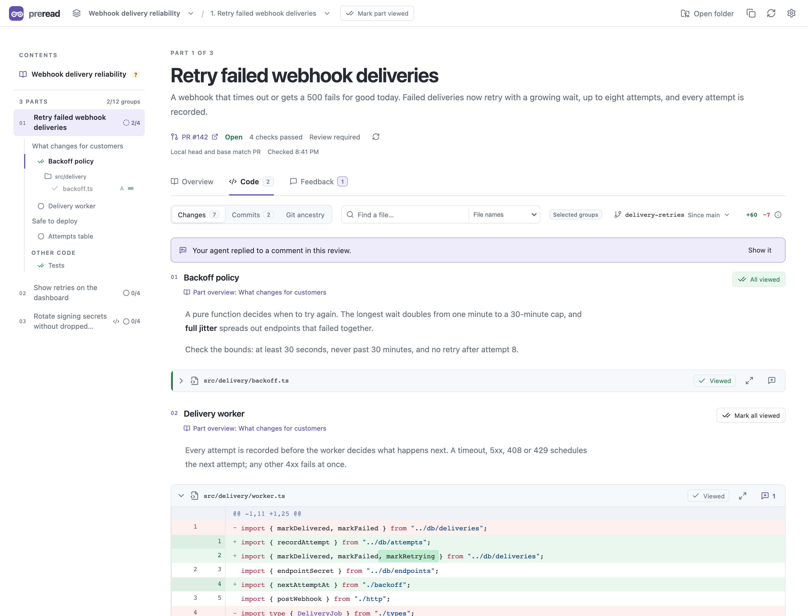
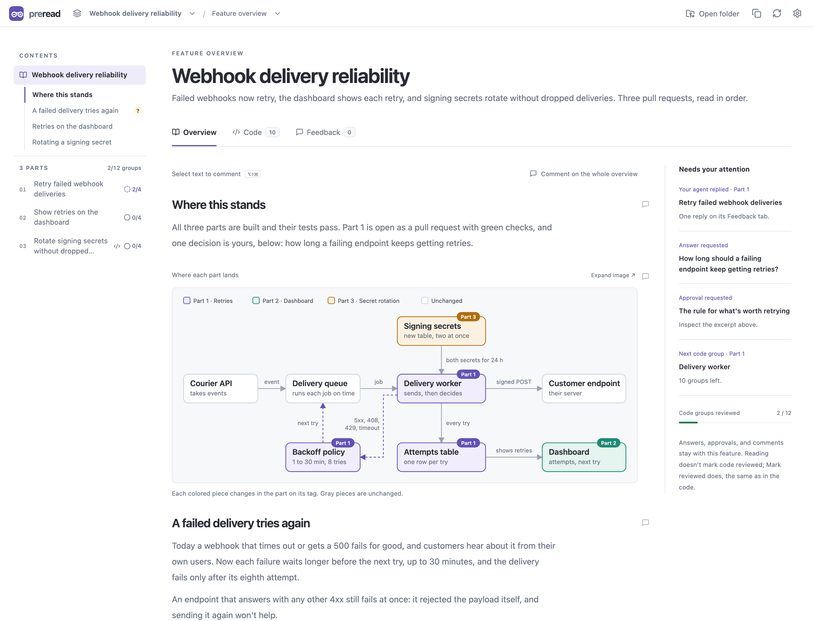
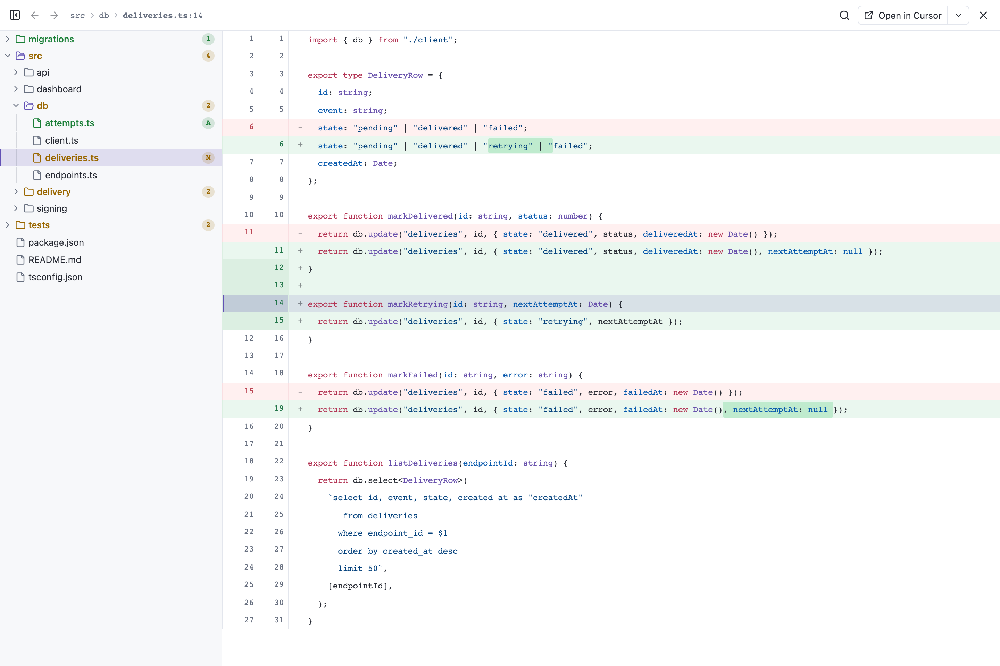
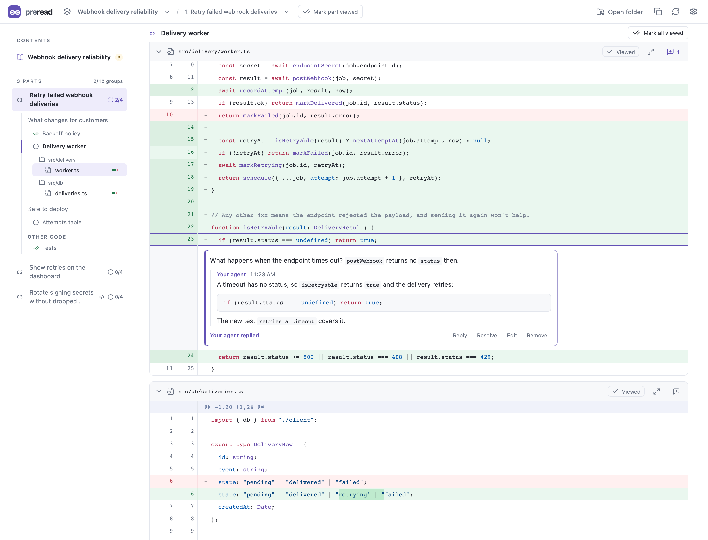
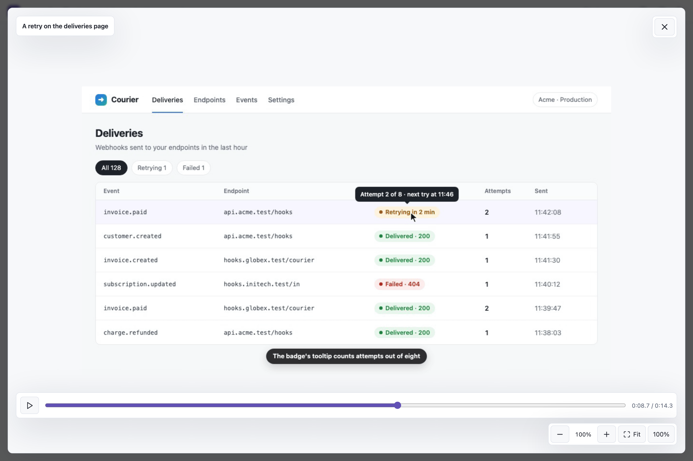

<p align="center">
  <picture>
    <source media="(prefers-color-scheme: dark)" srcset="docs/brand/preread-dark.svg">
    
  </picture>
</p>

<h3 align="center">Read what your coding agents wrote before it becomes a pull request.</h3>

<p align="center">
  Your agent hands you a reading list: the changes grouped, explained, and in order.<br>
  You read it on your own machine. Preread tracks what's left and reopens anything that changes after you read it.
</p>

<p align="center">
  <a href="#quick-start"><strong>Quick start</strong></a> ·
  <a href="#put-your-agent-on-it">Agent skill</a> ·
  <a href="#how-i-use-it">How I use it</a> ·
  <a href="docs/collections.md">Collections</a> ·
  <a href="#your-code-stays-on-your-machine">Privacy</a>
</p>

<picture>
  <source media="(prefers-color-scheme: dark)" srcset="docs/screenshots/review-dark.png">
  
</picture>

## Your agents write faster than you can read

Run a few agents in parallel and you come back to a pile of worktrees, branches, and thousands of changed lines. Reading them as pull requests means pushing code nobody has read yet, one branch at a time, and `git diff` is a wall of text with no story.

A pre-read is the memo you get before a meeting, so you walk in knowing what matters. Preread does that for code: your agent writes the memo, and you read the diff beside it.

## How it works

1. **Your agents work in worktrees.** One agent or ten, in one repository or several. Preread reads any Git checkout, whatever wrote the code.
2. **Your agent writes the reading list.** A collection is a short manifest of reviews, usually one for each pull request the work will ship as. Each names a worktree, the base to compare it with, and change groups that give each part of the diff a title and a note on what to check. The feature, and each of its pull requests, can open with an overview that tells the story and asks what the agent needs to know. The included [agent skill](skills/preread/SKILL.md) teaches your agent to write one and hand you the link.
3. **You read.** Start with the overview, open the code it points to, and mark files Viewed as you go. A group is reviewed when all of its files are Viewed, and a review is complete when all of its groups are. If the code changes after you've read it, it goes back on your list, showing only what changed.
4. **Your agent reads your feedback and replies.** Answers, approved excerpts, and comments you leave in an overview or on the code are saved for your agent, which collects what is waiting on it with `pnpm feedback` and replies under each item. You reply back, and either of you resolves the thread when it’s settled.

<picture>
  <source media="(prefers-color-scheme: dark)" srcset="docs/screenshots/overview-dark.png">
  
</picture>

## What makes it different

- **A feature overview before the code.** Your agent can open the feature, and each pull request in it, with a page that tells the story: Markdown, questions for you to answer, code excerpts for you to approve, call trees that fold like an outline, and local images, GIFs, and diagrams that open full screen to zoom, pan, or scrub. A Contents rail lists every part with its review status. Each section ends with the code groups it explains, ready to open or mark reviewed. The code opens in the same frame, and **Back** returns you to your place in the overview.
- **Change groups that say what to check.** Each one pairs files, or single hunks, with a title and a description in Markdown. A curated review shows only the hunks its groups select, so other work in the same files stays out of it. A review of the whole comparison puts anything unassigned under Other changes, so nothing hides.
- **Follow any name to its definition.** ⌘-click a call, constant, type, component, or prop in JavaScript or TypeScript to open where it's defined, in a full-window viewer of the worktree as the review shows it. Calls into installed packages open too, with the package's name and version. A changed file reads there as one whole-file diff, beside an Explorer of the whole worktree, Find, Back and Forward, and a button that opens the line in your editor.
- **Comments that stay with the code.** Comment on a line, a file, or a passage of an overview, in Markdown with syntax-colored code; a comment on an overview can carry screenshots you paste or drop in. A comment on a line follows it when edits move it, and your agent's replies appear under it within a second.
- **Re-reads show only what changed.** A Viewed mark is tied to the diff you read. When that diff changes, the mark clears, and the group reopens on just the changes since you viewed it.
- **One reading list across worktrees.** A collection spans worktrees and repositories. Each review has its own base, so a stacked branch shows only its own layer.
- **The pull request, once you open one.** Link a review to its GitHub pull request to see its state, checks, and review decision under its title and in the review picker, and whether your local head and base still match it. The feature overview lists every part's pull request.
- **Updates on your agent's cue.** After a change, your agent runs `pnpm refresh`, and the page you have open re-reads in place and keeps your scroll position and your marks.
- **Any stage of the work.** Branch commits, branch plus local edits, uncommitted changes, or staged changes.
- **A diff reader built for long reads.** Unified or split view, syntax highlighting that reads the whole file, line wrapping, ignore whitespace, expandable context, and before-and-after images. The file outline shows folders, each file's kind, and a meter of its changed lines, and the line count keeps runtime code apart from tests and lockfiles. Deep in a long group, a bar at the top keeps the group's name and **Mark all viewed** in reach.

<picture>
  <source media="(prefers-color-scheme: dark)" srcset="docs/screenshots/source-viewer-dark.png">
  
</picture>

## Quick start

> [!NOTE]
> Preread is software I build for myself, and it may change at any time as the way I work changes. If you depend on it, pin a commit or fork it.

You need Node.js 22.13 or later, pnpm 11, and Git 2.36 or later. Preread is developed on macOS, and the tests also run on Linux; Windows isn't supported. The [GitHub CLI](https://cli.github.com), signed in, is optional and adds pull request status.

Using a coding agent? [Install the skill](#put-your-agent-on-it) and ask for a review; your agent offers to clone and start Preread for you. To set it up by hand:

```sh
git clone https://github.com/joshmatz/preread.git
cd preread
pnpm install
pnpm build
pnpm start
```

Open <http://127.0.0.1:4780>, choose **Open folder**, and enter the absolute path of any repository or worktree. It starts with the branch's commits since your default branch; open the comparison beside the tabs to change the base or include local edits. Choose **Save a named review** to keep it.

Preread is at its best when your agent writes the reading list, so set that up next.

## Put your agent on it

The [`preread` skill](skills/preread/SKILL.md) teaches an agent the whole handoff: plan a collection, choose each base from the real branch ancestry, write and import the manifest, check what every group shows, refresh the page you have open, and hand you the link. It sets Preread up if you haven't, tells you when there's an update, and never marks anything reviewed for you.

Install it for all your projects with the [skills CLI](https://github.com/vercel-labs/skills):

```sh
npx skills add joshmatz/preread -g
```

Or link it into your agent's skills directory by hand, so it updates with your checkout. For Claude Code, from your Preread checkout:

```sh
mkdir -p ~/.claude/skills && ln -s "$PWD/skills/preread" ~/.claude/skills/preread
```

If you cloned Preread yourself, tell your agent where it lives, for example in your global agent instructions:

```text
Preread is checked out at ~/src/preread. Use the preread skill to present finished work before you push.
```

Now your agent hands you a link when work is ready to read, or whenever you ask it to present something in Preread:

```text
http://127.0.0.1:4780/?collection=webhook-reliability&review=delivery-retries
```

If your agent runs in a desktop app with a built-in browser, such as the Codex or Claude desktop app, it opens the review there too, beside the conversation.

Rather write collections yourself? The [collections guide](docs/collections.md) covers the format.

## How I use it

I run several agents at once, each in its own worktree, and nothing gets pushed until I've read it in Preread. A feature usually goes like this:

1. **Plan in an overview.** Before much code exists, I ask for a feature overview: what changes for the people who use it, a mockup or diagram, and each decision I need to make as a question with a recommended answer. I answer in the page, and the agent picks up my answers with `pnpm feedback`.
2. **Build in worktrees.** Each agent builds in its own worktree and splits the work into pull requests of about 1,000 lines. Nothing is pushed yet.
3. **"Show me in Preread."** The agent writes one review per pull request, each based on the branch below it, and gives each its own overview. Every description opens with what goes wrong today and what changes. Tests sit in their own groups, and each interface change comes with a recording of the real app. Where one of my decisions is the reason something works the way it does, the overview quotes me, with the date.
4. **A first read I don't have to do.** For a feature over about 3,000 lines of code outside tests, agents with no chat history each read one area first. They list code to delete, guards with no shown need, and every place they had to stop and look something up. The lead agent fixes what holds up before it hands me the link.
5. **Read.** The review opens in the browser built into my agent app, beside the conversation. Tests, fakes, lockfiles, snapshots, and generated files are already marked Viewed, so what's left is the logic. I read the overview, open the code it links, ⌘-click anything I don't recognize, and comment wherever something's off.
6. **Feedback and a re-read.** I tell the agent I left comments. It reads them, fixes the code, replies under each one, and refreshes my page. Each group it changed reopens on just what changed since I viewed it.
7. **Ship.** "Reviewed in Preread. Open the PRs." Only now does the agent push. A stack goes up one layer at a time, each once the one below is green, and each review links its pull request so the picker shows its checks.

<picture>
  <source media="(prefers-color-scheme: dark)" srcset="docs/screenshots/comments-dark.png">
  
</picture>

Someone else's pull request goes through the same loop: my agent checks the branch out into a worktree and writes the reading list. For design work on side projects, I often read only the overview and its recordings.

<picture>
  <source media="(prefers-color-scheme: dark)" srcset="docs/screenshots/gif-viewer-dark.png">
  
</picture>

The skill already does most of this. My own agent instructions add the rest:

```text
Don't push or open a pull request until I've read the work in Preread and said so.
Before you hand over a review, mark Viewed each file that holds no logic: tests, fakes, lockfiles, snapshots, and generated files.
For a feature over about 3,000 lines of code outside tests, have agents with no chat history read each area first, and fix what holds up before you hand it to me.
Where a decision of mine is the reason for a behavior, quote my words there, with the date.
```

## Your code stays on your machine

Preread runs where the code is. It only reads your repositories: it never checks out, stages, commits, fetches, or pushes, and it never sends your code anywhere. Apart from Git filling in a partial clone, described below, its only network calls are optional pull request status reads through the GitHub CLI.

- **Read-only Git.** Git runs from argument arrays, never through a shell. Hooks, fsmonitor, external diff tools, and textconv filters are off. Comparisons against the working tree read a private copy of the index, so Preread never writes `.git/index`.
- **Only files in the comparison.** The server reads file contents only for paths in the current comparison. An untracked symlink shows its target path and is never followed. Image previews are sent with a fixed image type under a sandboxing Content Security Policy, and SVG is never rendered, so a preview can't run script.
- **Loopback only.** The server binds to 127.0.0.1. Its API accepts only `127.0.0.1` and `localhost` hosts and rejects requests that come from any other origin, including other local ports, so websites can't read your code through it, even with DNS rebinding. Open pages poll a same-origin refresh counter, which carries no repository content.
- **No third-party requests from the page.** All assets are bundled. There are no fonts, CDNs, or analytics.
- **Data outside your repositories.** Collections and receipts live in `~/.preread` by default, in files only your user can read.

Git still applies a repository's own clean filters when it reads working-tree files, and in a partial clone it may download missing file contents from the remote to build a diff. As with any Git client, open only repositories whose `.git/config` you trust.

## Documentation

- [Overviews](docs/briefs.md): writing feature and part overviews, collecting answers and passage comments, and handing feedback to your agent.
- [Collections](docs/collections.md): the manifest format, the CLI, and how imports are checked.
- [Reference](docs/reference.md): reviewing, following code to its definitions, comments, keeping pages current, configuration, and limits.
- [DESIGN.md](DESIGN.md): the interface decisions.
- [AGENTS.md](AGENTS.md): rules for agents working on this repository.

## Development

```sh
pnpm dev                         # server with Vite middleware and hot reload
pnpm test                        # tests against disposable Git repositories
pnpm build                       # type check and production build
pnpm benchmark <collection-id>   # time opening and checking a collection on the running server
```

## License

[MIT](LICENSE)
